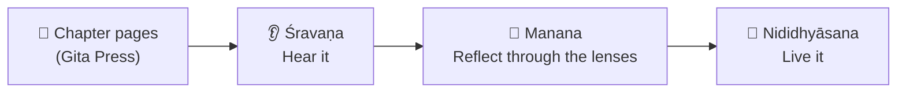

<div align="center">

# 🪷 Mahābhārata
### Śravaṇa · Manana · Nididhyāsana

*A chapter-by-chapter reading of the Mahābhārata: hear it, reflect on it, live it.*


</div>

---

> *aṣṭau ślokasahasrāṇi aṣṭau ślokaśatāni ca /*
> *ahaṃ vedmi śuko vetti saṃjayo vetti vā na vā //*
>
> "Eight thousand eight hundred verses: I know them, Śuka knows them, and Sañjaya may or may not."
> — Vyāsa on the knotted verses, Ādi Parva 1.81 (Gita Press numbering)

---

## 🧭 The method

Every chapter goes through the classical three steps of study.



| Step | Meaning | What the notes contain |
|---|---|---|
| 👂 **Śravaṇa** | Hearing | What the chapter actually says, in English, from its own pages only |
| 🧠 **Manana** | Reflection | The chapter read through whichever lenses genuinely fit |
| 🌱 **Nididhyāsana** | Living it | One practical takeaway |

---

## 🔍 The six lenses

| | Lens | The question it answers |
|---|---|---|
| 🕉️ | **Theological** | Who is the Divine here, and what does it reveal? |
| 🪔 | **Ādhyātmika** | What does this mean for my inner life? |
| 🧩 | **Psychological** | Why did this person act this way? |
| ⚖️ | **Ethical** (*dharma-sūkṣma*) | What should have been done, and where is dharma subtle? |
| 🎭 | **Literary** (*rasa*) | Why does the text feel the way it does? |
| 📜 | **Historical & textual** | How did this text reach me, as far as the page shows? |

A lens is used only where it genuinely fits. None is forced.

---

## 📏 Ground rules

- ✅ Everything comes **only from the chapter's own pages**: no outside stories, no TV or popular versions.
- ✅ Verses are quoted **only when they are on the page**, checked against the page image, in roman transliteration with English translation.
- ✅ Anything unclear is **flagged, not guessed**.
- ✅ The translator's notes are kept **separate from the text itself**.

---

## 📚 Progress

### Ādi Parva: 5 / 233 chapters

| # | Sub-parva | Chapters | Status |
|---|---|---|---|
| 1 | Anukramaṇikā | 1 | ✅ |
| 2 | Parvasaṅgraha | 2 | ✅ |
| 3 | Pauṣya | 3 | ✅ |
| 4 | Pauloma | 4–12 | 🟡 in progress |
| 5 | Āstīka | 13–58 | ⬜ |
| 6 | Aṃśāvataraṇa | 59–64 | ⬜ |
| 7 | Sambhava | 65–139 | ⬜ |
| 8 | Jatugṛha | 140–150 | ⬜ |
| 9 | Hiḍimbavadha | 151–155 | ⬜ |
| 10 | Bakavadha | 156–163 | ⬜ |
| 11 | Caitraratha | 164–182 | ⬜ |
| 12 | Svayaṃvara | 183–191 | ⬜ |
| 13 | Vaivāhika | 192–198 | ⬜ |
| 14 | Viduragamana-Rājyalambha | 199–211 | ⬜ |
| 15 | Arjunavanavāsa | 212–217 | ⬜ |
| 16 | Subhadrāharaṇa | 218–219 | ⬜ |
| 17 | Haraṇāharaṇa | 220 | ⬜ |
| 18 | Khāṇḍavadāha | 221–226 | ⬜ |
| 19 | Mayadarśana | 227–233 | ⬜ |

### Sabhā Parva: 0 / 81 chapters ⬜

---

## 🗂️ Structure

```
📁 reading/
   └─ 📁 01-adi-parva/
        ├─ 01-anukramanika.md
        ├─ 02-parvasangraha.md
        ├─ 03-paushya.md
        └─ 04-pauloma.md
📁 system/
   ├─ reading-rules.md         rules every session follows
   ├─ chapter-page-index.md    chapter → PDF page map
   ├─ adi-parva-contents.md    chapter list (233)
   ├─ sabha-parva-contents.md  chapter list (81)
   ├─ volume-1-pictures.md     list of illustrations
   └─ render-pages.swift       renders PDF pages to images
```

The source PDFs are not included in this repo.

---

<div align="center">

*Jaya: the original name of the epic.*

</div>
